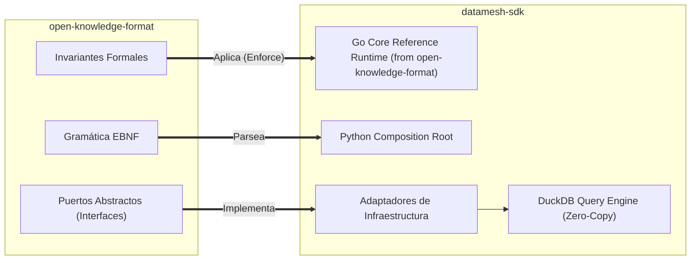
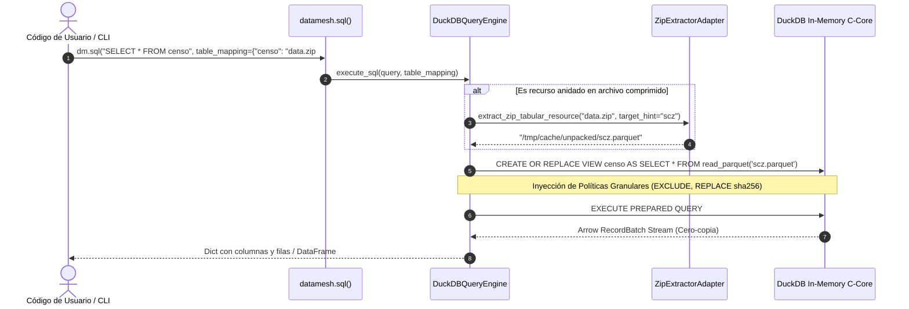

# Guía de Implementación Guiada por Especificación (Specification-Driven Design - SDD)
## DataMesh Core SDK: Arquitectura de Referencia, Implementación de Puertos y Guía de Conectores

> **Autoridad Normativa Upstream:** [`open-knowledge-format/docs/SPECIFICATION_DRIVEN_DESIGN.md`](/home/andreschirinos/Proyectos/open-knowledge-format/docs/SPECIFICATION_DRIVEN_DESIGN.md)  
> **ADR de Referencia:** [`ADR 0028: Dependencia Normativa Upstream de OKF v0.2`](file:///home/andreschirinos/Proyectos/datamesh-sdk/docs/decisions/0028-upstream-open-knowledge-format-normative-dependency.md)  
> **Fecha:** Octubre 2026  
> **Estado:** Aprobado para Implementación

---

## 1. El Paradigma SDD en DataMesh SDK

DataMesh SDK es la **implementación de referencia de nivel de producción** del estándar Open Knowledge Format (OKF/ODKF v0.2). En este repositorio, el código fuente no inventa semántica ni formatos; cada módulo, puerto y adaptador constituye la materialización de los contratos definidos en la especificación normativa upstream.



---

## 2. Mapa de Implementación de Puertos Abstractos

Conforme a la Sección 16 de `open-knowledge-format/SPEC.md` y la especificación SDD normativa, la siguiente tabla detalla la correspondencia entre los puertos abstractos y las clases de implementación en el SDK:

| Puerto Normativo | Interfaz Abstracta Python | Implementación Go Core | Adaptadores Concretos en SDK |
| :--- | :--- | :--- | :--- |
| **`StoragePort`** | `datamesh.ports.outbound.StoragePort` | `core-go/ports/storage.go` | `LocalFileAdapter`, `HttpRangeAdapter`, `S3StorageAdapter` |
| **`StoragePort (Zip)`** | `ZipExtractorAdapter` | `core-go/adapters/storage/zip.go` | `extract_zip_tabular_resource` (con soporte RFC 3986 fragment identifiers) |
| **`CatalogResolverPort`** | `CatalogResolverPort` | `core-go/ports/catalog.go` | `GitStaticCatalogAdapter`, `LocalDirCatalogAdapter`, `CKANResolverAdapter`, `KademliaDHTAdapter` |
| **`DataProductResolverPort`**| `DataProductResolverPort`| `core-go/ports/dataproduct.go`| `ResolveDataProductUseCase`, `UnifiedMetadataReader` |
| **`QueryEnginePort`** | `QueryEnginePort` | `core-go/ports/engine.go` | `DuckDBQueryEngine` (embebido), `ArrowFlightSQLEngine` (telemetría) |
| **`TrustVerifierPort`** | `TrustVerifierPort` | `core-go/domain/crypto.go` | `SSHKeyTrustAdapter`, `GitHubDIDVerifier`, `HashlibChecksumAdapter` |

---

## 3. Guía Paso a Paso para Implementar Nuevos Adaptadores

Cualquier nuevo conector o adaptador de infraestructura debe construirse siguiendo este patrón riguroso:

### 3.1 Implementación de un Nuevo Storage Adapter
Para dar soporte a un nuevo protocolo de almacenamiento (e.g., IPFS Bitswap o Azure Blob Storage):

1. **Crear archivo del adaptador:** Ubicarlo en `datamesh/adapters/storage/<nombre>_storage.py`.
2. **Implementar el contrato del puerto:**
   ```python
   from __future__ import annotations
   from typing import BinaryIO
   from datamesh.ports.outbound.storage_port import StoragePort
   from datamesh.domain.exceptions import ResourceNotFoundError

   class CustomStorageAdapter(StoragePort):
       """Adaptador de almacenamiento conforme al SDD de OKF v0.2."""

       def read(self, uri: str) -> bytes:
           # Precondición: validar prefijo de URI
           if not uri.startswith("custom://"):
               raise ValueError(f"URI no soportada por este adaptador: {uri}")
           ...

       def range_read(self, uri: str, offset: int, length: int) -> bytes:
           # Invariante SDD: lectura estricta por rangos RFC 7233
           ...

       def stat(self, uri: str) -> dict:
           # Retorna longitud, hash SHA-256 y fecha
           ...
   ```
3. **Registrar en el Composition Root:** Añadir la regla de despacho en `datamesh/core.py` o en la fábrica de adaptadores.
4. **Escribir pruebas herméticas:** Añadir tests unitarios con mocks en `bindings/python/tests/test_storage_custom.py`.

---

## 4. Taxonomía Estricta de Errores y Excepciones

Para cumplir con el estándar RFC 7807 (Problem Details for HTTP APIs) y garantizar interoperabilidad entre Go, Python y CLI, el SDK estandariza sus clases de excepción:

| Código de Error SDD | Clase de Excepción en Python | Equivalente Go Core | Causa Raíz |
| :--- | :--- | :--- | :--- |
| `ERR_OKF_NOT_FOUND` | `ResourceNotFoundError` | `ErrResourceNotFound` | El recurso, dataset o catálogo no existe en la URI provista. |
| `ERR_OKF_CYCLIC_FEDERATION` | `CyclicFederationError` | `ErrCyclicCatalog` | Se detectó un bucle recursivo al navegar catálogos federados. |
| `ERR_OKF_MAX_DEPTH` | `MaxCatalogDepthExceededError` | `ErrMaxDepthExceeded` | La profundidad de resolución superó el límite de $MAX\_DEPTH=8$. |
| `ERR_OKF_POLICY_VIOLATION` | `PolicyViolationError` | `ErrPolicyViolation` | Consulta SQL viola la regla de microdatos (`zero_microdata`) o columnas ocultas. |
| `ERR_OKF_CRYPTO_FAILED` | `CryptographicVerificationError` | `ErrSignatureInvalid` | La firma Ed25519/OpenSSH no coincide con la clave pública anunciada. |
| `ERR_OKF_INVALID_FRAGMENT` | `InvalidFragmentIdentifierError` | `ErrInvalidFragment` | El subarchivo solicitado en un archivo ZIP no existe dentro del archivo comprimido. |

---

## 5. Arquitectura del Motor Analítico DuckDB y Zero-Copy Pipeline

El SDK aprovecha la tecnología columnar de **DuckDB y Apache Arrow** para garantizar máxima velocidad sin copias intermedias:



---

## 6. Verificación de Conformidad con la Suite ECTS

El cumplimiento de los requisitos del SDD se valida automáticamente en la suite de integración de Pytest:

```bash
# Ejecutar verificación formal de los 4 bundles bolivianos
pytest bindings/python/tests/test_bolivian_fair_bundles.py -v

# Ejecutar auditoría completa de integridad de referencia
pytest bindings/python/tests/test_reference_integrity.py -v
```

---

## 7. Próximos Pasos en la Hoja de Ruta de Implementación

1. **Cliente HTTP Range Streaming Puro:** Evolucionar `HttpRangeAdapter` para parsear streams ZIP remotos directamente en chunks de memoria sin tocar disco local.
2. **Cliente Kademlia DHT Go:** Integrar el resolver de subespacios semánticos en `core-go/adapters/p2p/` para resolver direcciones `@catalogo` en redes P2P activas.
3. **Exportador WASM:** Compilar Go Core a WebAssembly para permitir ejecución de catálogos soberanos en el navegador del usuario final.
